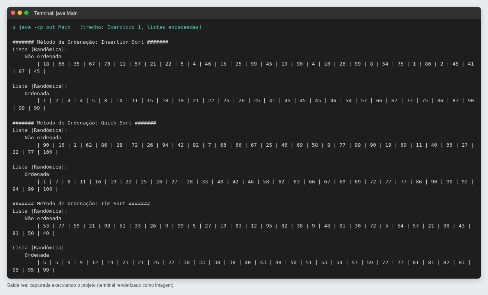
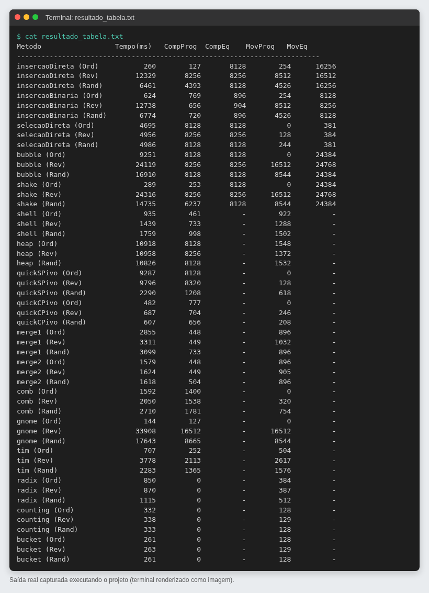

# 📊 Métodos de Ordenação em Java: Listas Encadeadas e Arquivos Binários

Implementação de **17 algoritmos de ordenação** em Java aplicados a duas estruturas: **lista duplamente encadeada** em memória e **arquivo binário** acessado diretamente em disco (`RandomAccessFile`). Para os arquivos, o programa mede **tempo de execução, comparações e movimentações** em entradas ordenadas, reversas e aleatórias, compara com as **equações teóricas** e gera a tabela `resultado_tabela.txt`.

Trabalho do 1º bimestre da disciplina **Pesquisa e Ordenação** (Unoeste), Prof. Francisco Assis da Silva.


## 📸 Screenshot

Execução real do Exercício 1 (ordenação de listas encadeadas com 32 valores aleatórios), saída do terminal renderizada como imagem:



Tabela gerada pelo Exercício 2 nessa mesma execução (os tempos variam conforme a máquina e o disco):



## ✨ Funcionalidades

### Exercício 1: Lista duplamente encadeada
- Gera uma lista com 32 valores aleatórios, ordena e exibe a lista **antes e depois** para cada método.
- Métodos: Inserção Direta, Inserção Binária, Seleção Direta, Bubble, Shake, Shell, Heap, Quick sem pivô, Merge, Comb, Gnome, Tim, Counting, Radix e Bucket.

### Exercício 2: Arquivo binário
- Gera três arquivos com **128 registros** cada: **ordenado**, **reverso** e **randômico**. Cada registro tem um campo `numero` e um campo `lixo` de 1022 caracteres, para simular registros grandes em disco.
- Antes de cada teste, o arquivo original é clonado para um arquivo auxiliar.
- Para cada um dos 17 métodos e cada tipo de entrada, registra:
  - tempo de execução (ms, com `System.currentTimeMillis()`);
  - comparações e movimentações **contadas no código**;
  - comparações e movimentações **pelas equações teóricas** (quando definidas para o método).
- Métodos: Inserção Direta, Inserção Binária, Seleção Direta, Bubble, Shake, Shell, Heap, Quick sem pivô, Quick com pivô, Merge (1ª e 2ª implementação), Comb, Gnome, Tim, Radix, Counting e Bucket.
- Grava tudo em `resultado_tabela.txt`.

## 📋 Exemplo da tabela gerada

Trecho do `resultado_tabela.txt` incluído no repositório:

```txt
Metodo                  Tempo(ms)   CompProg  CompEq    MovProg   MovEq
--------------------------------------------------------------------------
insercaoDireta (Ord)          1155        127       8128        254      16256
insercaoDireta (Rev)         53308       8256       8256       8512      16512
insercaoDireta (Rand)        27124       4246       8128       4380      16256
bubble (Rev)                104625       8256       8256      16512      24768
quickCPivo (Rand)             2881        735          -        188          -
merge2 (Rand)                 6797        533          -        896          -
```

`CompProg`/`MovProg` são os valores contados pelo programa; `CompEq`/`MovEq`, os valores das equações (`-` quando não há equação para o método).

## 📁 Estrutura do projeto

```
sorting-algorithms-benchmark-java/
├── src/
│   ├── Main.java              # Executa os dois exercícios e gera a tabela
│   ├── Arquivo/
│   │   ├── Arquivo.java       # Métodos de ordenação em arquivo binário + contadores
│   │   └── Registro.java      # Registro (numero + lixo) gravado no arquivo
│   └── Lista/
│       ├── Lista.java         # Lista duplamente encadeada + métodos de ordenação
│       └── No.java
├── resultado_tabela.txt       # Resultado de uma execução
└── *.dat                      # Gerados na execução (fora do Git)
```

## ▶️ Como executar

Pré-requisito: **JDK 17** (ou outro JDK recente).

```bash
git clone https://github.com/lukinha21/sorting-algorithms-benchmark-java.git
cd sorting-algorithms-benchmark-java

javac -encoding UTF-8 -d out src/Main.java src/Arquivo/*.java src/Lista/*.java
java -cp out Main
```

O Exercício 1 é exibido no terminal. O Exercício 2 cria os arquivos `.dat` na pasta atual e, ao terminar, grava `resultado_tabela.txt`. Como cada registro é lido e gravado direto no disco, essa parte leva alguns minutos.

Também é possível abrir a pasta no IntelliJ IDEA e executar `Main`.

## 👨‍💻 Autores

**Lucas Alexandre**, estudante de Sistemas de Informação na Unoeste

- GitHub: [@lukinha21](https://github.com/lukinha21)
- LinkedIn: [Lucas Silva](https://www.linkedin.com/in/lucas-silva-025583180)

Projeto desenvolvido com **Beatriz de Oliveira**.
